


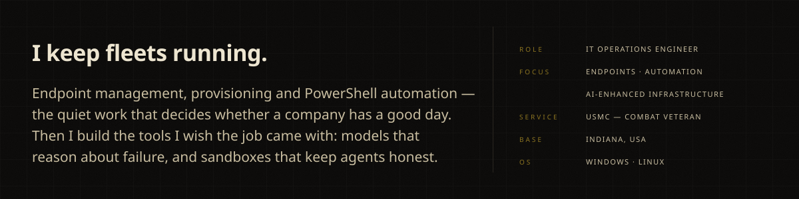


<a href="https://github.com/B1tR0n1n/overlord"></a>
<a href="https://github.com/B1tR0n1n/sable"></a>
<a href="https://github.com/B1tR0n1n/infra-toolkit"></a>
<a href="https://github.com/B1tR0n1n/sable-feed"></a>

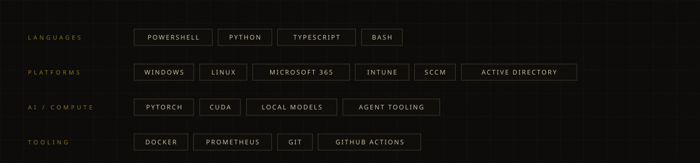



<picture>
  <source media="(prefers-color-scheme: dark)" srcset="https://raw.githubusercontent.com/B1tR0n1n/B1tR0n1n/output/snake-dark.svg" />
  
</picture>


<a href="https://b1tr0n1n.github.io">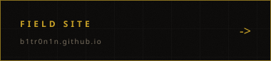</a>
<a href="https://www.linkedin.com/in/keith-burns-t">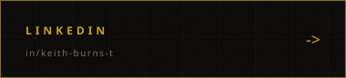</a>
<a href="https://github.com/B1tR0n1n?tab=repositories">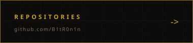</a>


